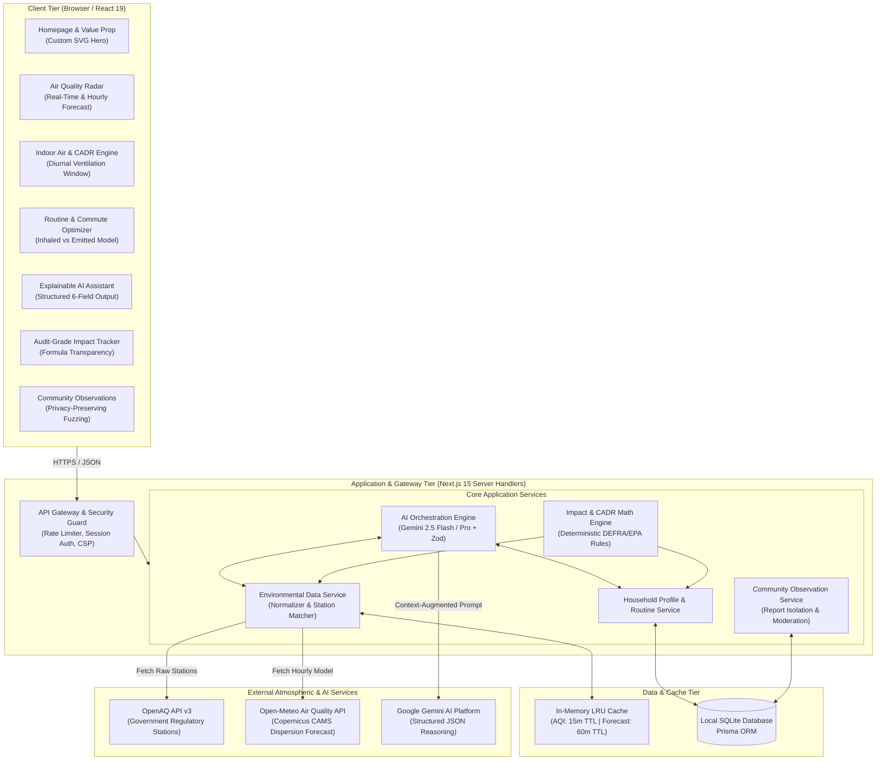
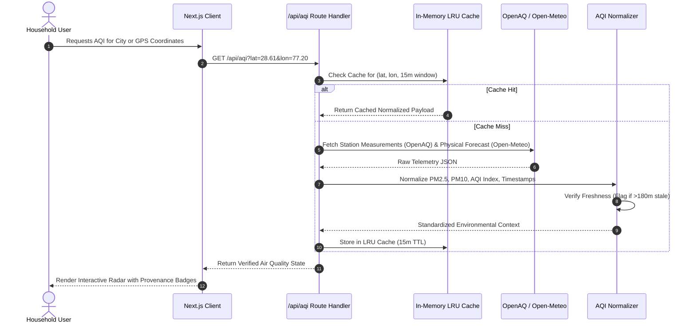
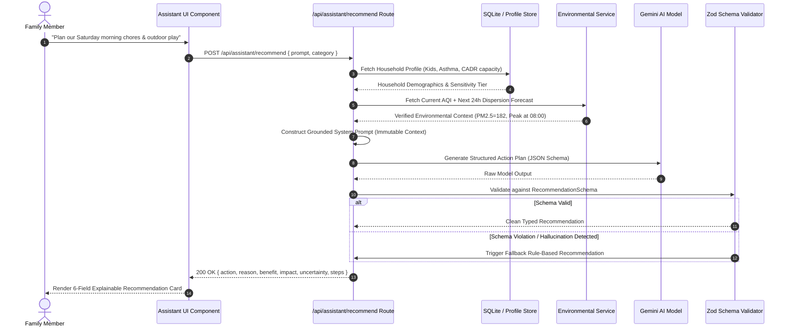

# BreatheWise AI — System Architecture & Component Specification
**Document ID:** ARCH-001  
**Module:** M0 Discovery & Architecture  
**Date:** 2026-11-20  

---

## 1. Architectural Philosophy & Principles
1. **Deterministic Environmental Ground Truth:** Atmospheric measurements and physical dispersion forecasts are handled exclusively through verified, deterministic services. The Generative AI model is strictly prohibited from inventing or hallucinating real-time numerical readings.
2. **Safety-First Recommendation Hierarchy:** Human biological safety strictly overrides carbon emission reduction. When outdoor air is hazardous ($PM2.5 > 250 \mu g/m^3$), the system prioritizes protection (recommending sealed indoor spaces or filtered transit) over active transit (walking/cycling).
3. **Auditable Mathematics:** All environmental impact claims (CO2 avoided, PM2.5 reduced) are calculated using standardized, peer-reviewed conversion constants with explicit formulas and uncertainty intervals exposed to the user.
4. **Radical Data Lineage & Separation:** Certified regulatory station data is strictly isolated from subjective, crowdsourced community reports.
5. **Defensive Graceful Degradation:** When upstream APIs encounter rate limits, network timeouts, or station outages, the application degrades gracefully to cached or modeled values with explicit status flags, never crashing or displaying empty dashboards.

---

## 2. End-to-End System Architecture Diagram

---

## 3. Data Flow Architecture

### 3.1 Air Quality Ingestion & Normalization Flow

### 3.2 AI Recommendation & Explainability Flow

---

## 4. Component Boundaries & Responsibilities

| Component Name | Boundary Responsibility | Prohibited Actions |
|---|---|---|
| **Environmental Data Service** | Fetch, validate, normalize, and cache external atmospheric telemetry. Compute official US EPA and India NAQI piecewise index conversions. | Must NOT accept client-supplied AQI numbers. Must NOT invent readings if sensors fail. |
| **Mathematical Impact Engine** | Calculate vehicle emissions avoided, distance shifted, and room HEPA CADR requirements using deterministic formulas. | Must NOT invent arbitrary multipliers or "magical tree" claims without explicit baselines. |
| **AI Assistant Orchestrator** | Inject verified environmental context and household profiles into structured LLM prompts. Enforce Zod schema output validation. | Must NOT allow LLM to guess atmospheric readings or provide clinical medical diagnoses. |
| **Community Observation Service** | Ingest crowdsourced reports (odor, smoke, open burning). Perform geographic coordinate fuzzing (~1.1 km) for privacy. | Must NOT mix community observations with certified regulatory station feeds. |
| **Household Profile Service** | Store and retrieve family member vulnerabilities, home dimensions, and commute routes. | Must NOT expose profile details across unauthenticated sessions. |

---

## 5. Technology Stack Summary & Justification

| Layer | Chosen Technology | Version | Technical Justification |
|---|---|---|---|
| **Frontend Framework** | Next.js App Router | 15.x / React 19 | Server Components for instant SSR of air quality reports; zero client waterfall for environmental data; seamless streaming for AI recommendations. |
| **Styling & Design Tokens** | Tailwind CSS v4 + Radix UI | v4.x / Radix 1.x | Utility-first architecture with custom design tokens (`oklch` / hex) supporting the required warm-sage palette; unstyled accessible primitives guarantee WCAG AA compliance. |
| **Iconography** | Phosphor Icons & Lucide | Latest | Vector SVGs with uniform stroke width; avoids amateurish emojis in structural controls. |
| **Database & ORM** | SQLite + Prisma ORM | Prisma 6.x | Zero-config, deterministic local database ideal for competition verification; strict TypeScript types; easy migration path to PostgreSQL. |
| **Validation Engine** | Zod | 3.24.x | Runtime validation of external API responses, user inputs, and LLM structured outputs. |
| **AI Model & SDK** | Google Gemini 2.5 Flash / Pro | Google GenAI SDK | State-of-the-art structured JSON reasoning, high speed for real-time recommendations, cost efficiency, and large context window. |
| **Testing Harness** | Vitest + Playwright | Latest | Sub-second unit test execution for mathematical algorithms; automated headless browser accessibility (axe-core) and user journey testing. |
